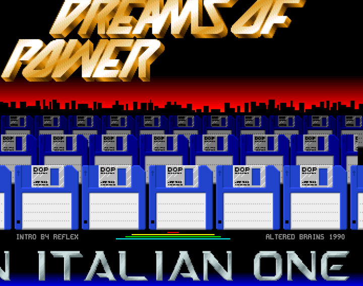

# Dreams of Power – Born (1990)

The intro that announced the Italian group **Dreams of Power** ("A NEW GROUP IS BORN !!!"), from Lugo (Ravenna). It was coded for them by **Reflex** of **Altered Brains**: the screen says *INTRO BY REFLEX* and *ALTERED BRAINS 1990*, and the scrolltext thanks "REFLEX / ALTERED BRAINS FOR THIS COOL INTRO". The music is "going strong", a ProTracker module made with samples from the ST sample disks.

<p align="center">
  
</p>

Everything is on one screen, from top to bottom:

- the **DREAMS OF POWER logo**, cut in two halves that swing sideways, each one on its own sine curve;
- a **red sky and skyline**, made with copper colour changes and a one-bitplane silhouette;
- three rows of **floppy disks** in parallax, moving at three different speeds;
- a small **equalizer**: four lines whose length follows the four audio channels;
- the **scroller**, with a 3-bitplane 32-pixel font, bent line by line into a wave. Its speed, the height and the length of the wave, and pauses, are set by commands inside the text.

The left mouse button returns to the CLI.

## Contents of the repository

| Path | What it is |
|---|---|
| [DreamsOfPower-Born](DreamsOfPower-Born) | the original executable, packed |
| [DreamsOfPower-Born.asm](DreamsOfPower-Born.asm), [.cnf](DreamsOfPower-Born.cnf) | IRA disassembly of the original executable (depacker + packed data) |
| [work/dreams.asm](work/dreams.asm) | **relocatable rebuild** of the whole intro, assembles with vasm |
| [work/Makefile](work/Makefile) | build, check and run targets |
| [work/dreams_unpacked](work/dreams_unpacked) | the program that the original executable unpacks: a normal AmigaDOS executable |
| [work/dreams_unpacked.asm](work/dreams_unpacked.asm), [.cnf](work/dreams_unpacked.cnf) | raw IRA disassembly of it, with the config that names code areas and labels |
| [work/data_55000.bin](work/data_55000.bin) | the graphics and the music, as the program unpacks them at `$55000`; the rebuild includes this file |
| [work/decrunch.py](work/decrunch.py) | both depackers in Python; recreates `dreams_unpacked` and `data_55000.bin` from the original file |
| [work/checkreloc.py](work/checkreloc.py), [work/hunkdata.py](work/hunkdata.py) | used by `make verify` |
| [work/extract_assets.py](work/extract_assets.py) | extracts the assets |
| [work/assets/](work/assets) | the extracted assets (see [Assets](#assets)) |
| [docs/screenshots/](docs/screenshots) | screenshots from the tests |

## Build and run

You need [vasm](http://sun.hasenbraten.de/vasm/) (`vasmm68k_mot`), `exe2adf`, Python 3 (with Pillow for the assets) and FS-UAE.

```sh
cd work
make            # dreams (AmigaDOS executable) + dreams.adf (bootable disk)
make verify     # see "How it was checked"
make assets     # extracts the assets
make run        # FS-UAE: A500, KS 1.3, 512K chip + 512K slow
make run600     # FS-UAE: A600, KS 2.05, 1MB chip (stock)
make run1200    # FS-UAE: A1200, KS 3.1, 2MB chip, no fast RAM
```

To get the unpacked program and data back from the original file:

```sh
python3 work/decrunch.py DreamsOfPower-Born dreams_unpacked data_55000.bin
```

## Testing

All tests were done in FS-UAE 3.1.66, booting a disk (or, for the CD32, a CD) whose startup-sequence runs the intro. Each run lasted about a minute and a half, then the left mouse button, then a command typed into the shell.

| Machine | Original | Rebuild |
|---|---|---|
| A500: 68000, OCS, KS 1.3, 512K chip + 512K slow | runs; after the exit, *Guru Meditation #00000004* (illegal instruction) | works, clean return to the shell |
| A500: same, 512K chip only | works | works, clean return to the shell |
| A600: 68000, ECS, KS 2.05, 1MB chip | only the copper colours, no graphics (bitplane DMA is off, see below) | works, clean return to the shell |
| A600: same, with three more floppy drives | same as above; started from the ItaloDisco menu, where DMA is on, it freezes with the logo half drawn and no scroller | works, clean return to the shell |
| A1200: 68020, AGA, KS 3.1, 2MB chip | only the copper colours, no graphics | works, clean return to the shell |
| A1200: same + 4MB fast RAM | only the copper colours, no graphics | works, clean return to the shell |
| CD32: 68020, AGA, KS 3.1 (40.60), booted from a CD with only the intro | works | works, clean return to the shell |

The Guru on the A500 with slow RAM comes right after the exit; I did not trace it, but the most likely cause is the memory at `$55000`–`$7E0B4` that the original overwrites and then clears without owning it.

What goes wrong in the original is explained in [Bugs in the original](#bugs-in-the-original-and-fixes).

## The packed executable

The original file is 77,836 bytes and has two hunks: a 524-byte code hunk with the depacker, and an 82,324-byte data hunk with the packed data. It is an *executable cruncher*: the packed data is a whole AmigaDOS executable, and the header does what `LoadSeg()` would do with it.

1. The packed stream is unpacked inside the data hunk, at offset `$200`. The format is the one of **PowerPacker**: the stream is read backwards, a 32-bit bit buffer is refilled from the end, and matches use offsets of 9, 10, 11 or 11 bits (the table at `$32454` in [the disassembly](DreamsOfPower-Born.asm)). A literal run (`0`, then a count in 2-bit steps, 3 means "more") is always followed by a match; a match is a 2-bit length code, and for length 4 or more a 1-bit choice between a 7-bit and a long offset, plus extra 3-bit length steps.
2. The result is an executable with one **CHIP code hunk of 80,224 bytes** (380 relocations) and a 4-byte BSS hunk. The header allocates them with `AllocMem()` (with `MEMF_CHIP` as the hunk asks), copies the data, applies the relocations, frees the packed data, links the new hunks into the process (`cli_Module`), and jumps to the first one.

[decrunch.py](work/decrunch.py) follows the 68000 code step by step; the stream is used up exactly when the output is complete.

So, unlike many packers of the time, the outer layer is clean: the problems are in the program itself.

## The program

The code hunk starts with code (up to about `$1B2C`, the ProTracker replay included), then the variables, the copper list (`$1C94`), a packed block (`$2334`) and the scrolltext (`$1292C`).

### Memory it takes without asking

The first thing the program does is unpack the block at `$2334` (with a **ByteKiller** depacker, the routine at `$2F8`) **to the fixed address `$55000`**: 111,188 bytes of graphics and music, up to `$70254`. It then uses `$70254`–`$7E0B4` as screen memory. In all it takes **168 KB of chip RAM, `$55000`–`$7E0B4`, that it never allocates**, and at the exit it clears it.

| Address | Content | Name in the rebuild |
|---|---|---|
| `$55000` | logo, 256×84, 4 bitplanes | `Data55` |
| `$57A00` | palette of the logo (16 colours) | `Pal1` |
| `$57A20` | scroller font, 320×160, 3 bitplanes | `FontGfx` |
| `$5C520` | palette of the scroller (8 colours) | `Pal3` |
| `$5C530` | floppy disks, 320×64, 3 bitplanes | `DiskGfx` |
| `$5E330` | palette of the disks (8 colours) | `Pal2` |
| `$5E340` | sine table, 1,256 bytes, and a second copy | `SineTab` |
| `$5ED10` | skyline, one bitplane | `BarPlane` |
| `$5EF48`, `$5F208` | the two bitplanes of the equalizer | `EqPlane1`, `EqPlane2` |
| `$5F4CC` | ProTracker module "going strong", 68,968 bytes | `MtModule` |
| `$70254` | logo screen, 4 bitplanes | `Screens` |
| `$73C14`, `$78054` | the rows of disks (two playfields) | `BgPlanes`, `MidPlanes` |
| `$7C494` | scroller screen, 3 bitplanes | `WavePlanes` |

If anything else lives there (the program's own hunk, a stack, the buffers of a disk drive or of a filesystem) it is overwritten. With the 512 KB of chip RAM of an A500 there is usually room above the loaded program; on an A600 with three more floppy drives, started from the ItaloDisco menu, the intro freezes with the logo half drawn and no scroller.

### How the intro works

- **Start-up**: unpacks the data, `Forbid()`, opens `graphics.library`, saves `gb_LOFlist` (offset 50) and puts its own copper list there, so that the OS loads it every frame. It fades the colours in, draws the rows of disks into their screens once, builds the per-line part of the copper list, initialises the music and puts its level 3 handler at `$6C`. The handler calls `mt_music` and then jumps to the old vector, with a `JMP` whose address is written into the code.
- **Main loop**: waits while the beam is outside lines `$80`–`$F0` (`CMPI.B #$F0,VHPOSR` / `BGT`, a signed comparison), then moves the logo halves (`MoveBars`), the scroller (`Scroller`), the wave (`WaveLogo`), the equalizer lines (`EqLines`) and the disks (`Parallax`). In FS-UAE it runs exactly once per frame on an A500 and on an A1200 alike (2,503 loops in 2,502 frames, 2,790 in 2,789, measured with the CIA-A time-of-day counter).
- **Logo**: the copper list shows it twice, the top half from line `$21` and the bottom half from line `$4A`, each with its own bitplane pointers and `BPLCON1` scroll, computed from the sine table, so that the two halves swing independently.
- **Disks**: a dual-playfield area (6 bitplanes, `BPLCON0` = `$6400`) with two rows that scroll at 1 and 2 pixels per frame, and a third row below at 4 pixels per frame.
- **Equalizer**: `mt_music` sets a level for each channel when it plays a note, `EqDecay` lowers it by 5 every frame, and `EqLines` draws four lines with the blitter's line mode (`DrawLine`).
- **Scroller and wave**: `Scroller` draws the characters with the blitter into `WavePlanes` (each character is 1 or 2 cells of 16×32 pixels, from `FontTab`); the copper list has 40 lines, each one loading the three bitplane pointers of the scroller with an offset read from the sine table (`WaveLogo`), which bends the text into a wave.

Commands in the scrolltext (`|` followed by a letter and a digit):

| Command | Effect |
|---|---|
| `|sN` | speed, N pixels per frame |
| `|pN` | length of the wave: step in the sine table, N×10 |
| `|aN` | height of the wave, N×2 |
| `|wN` | pause the scroller for N×40 frames |
| `$00` | start the text again |

### Music

"**going strong**": a 31-sample ProTracker module, 68,968 bytes, 12 samples, 18 patterns, 37 positions. The sample names show where the sounds come from: `st-04:440THICK-BK`, `st-06:Snare13`, `st-06:HighHat4`, `st-20:DDM220WoodBlock`, `st-04:Klick`, `st-01:FunBass`, `st-15:strike2`, `st-19:Tidpip`, `st-01:Magic`, `st-01:Gato`, `st-03:cl-mtrumpet`, `st-01:PopBass`. The replay is the standard ProTracker one, with an extra call to `EqDecay` for the equalizer.

### The scrolltext

[work/assets/scrolltext.txt](work/assets/scrolltext.txt). It begins with "HI !!! A NEW GROUP IS BORN !!! ANOTHER ???", insists that this one is different "BECAUSE IT'S AN ITALIAN ONE !!", and then spells out the name, slowly and with a big wave: "DREAMS OF POWER". To contact the group you have to write a message, put it in a bottle ("POSSIBLY OF BEER"), and throw it into the sea, then "WAIT AND HOPE" ("REMEMBER YOU MUST CORK IT !!!"). It greets Reflex / Altered Brains for the intro, then Altered Brains, Anonymia, Ghostly Spreaders, Italian Cracking Service, Masterforce, Phaze 101 and Zero Defects, and gives the address to write on the bottle: *Dreams of Power, Via Foro Boario 3, 48022 Lugo, Ravenna, Italy*.

## Assets

All in [work/assets/](work/assets):

| File | Content |
|---|---|
| `going_strong.mod` | the music, ready to play in any ProTracker player |
| `logo.png` | the DREAMS OF POWER logo, 256×84, 16 colours |
| `font.png` | the scroller font, 320×160, 8 colours, enlarged 2× |
| `fonttab.txt` | where each character is in the font, and how wide it is |
| `disks.png` | the five floppy disks of the parallax, 320×64, 8 colours, enlarged 2× |
| `palettes.txt` | the three palettes |
| `scrolltext.txt` | the scrolltext, with its commands |

## The relocatable rebuild

[work/dreams.asm](work/dreams.asm) is the program as vasm source:

- every address is a label; the 168 KB at `$55000`–`$7E0B4` are now two hunks of the program: `data55` (`DATA_C`, 111,188 bytes, the graphics and the music **already unpacked**, from `data_55000.bin`) and `screens` (`BSS_C`, 56,928 bytes);
- the code, the variables and the scrolltext are a `CODE` hunk that can go to any memory; the copper list is a small `DATA_C` hunk;
- the bitplane pointers in the copper list are constant words in the original: the macro `CPTR` leaves them zero and records them in a table, and `FixCopper` fills them in at start-up;
- the per-line part of the copper list (`CopWave`) set only the low words of the three scroller pointers, which works only if the scroller screen does not cross a 64 KB boundary; each line now sets both halves (32 bytes per line instead of 20), and `BuildWaveCop` and `WaveLogo` write both.

Since the block at `$55000` is stored already unpacked, the packed copy and the depacker are not needed at run time.

### Memory

| | Original | Rebuild |
|---|---|---|
| allocated | 80,228 bytes chip (code hunk + 4-byte BSS) | 11,792 any + 2,176 chip (copper) + 111,188 chip + 56,928 chip |
| taken without allocating | 168,116 bytes chip at `$55000` | – |
| total | 248,344 | 182,084 |

### How it was checked

Every block that had to change keeps the original instructions in an `IFD ORIGINAL` part. `make verify`:

1. assembles the source with `-DORIGINAL` at `ORG 0` (and the data at `$55000`/`$70254`): the result must be **identical, byte for byte, to the code hunk of the unpacked program**;
2. assembles it again at `$100000`, with the data moved by `$100000` too, and compares the two: every difference must be the high word of an address (457 of them). [checkreloc.py](work/checkreloc.py) also scans the source, outside the `ORIGINAL` parts, for numbers that look like addresses in `$40000`–`$7FFFF` and for copper moves that hold the high half of a pointer.

Then the rebuild was run on all the machines in [Testing](#testing).

### Bugs in the original and fixes

These are fixed in the rebuild and marked `fix:` in the source.

| Bug | Effect | Fix |
|---|---|---|
| The program unpacks to `$55000` and uses `$55000`–`$7E0B4` without allocating it | depends on what is there: on an A600 with three more floppy drives (from the ItaloDisco menu) the intro freezes, the logo half drawn and no scroller; on an A500 with slow RAM, a Guru right after the exit | the data and the screens are hunks of the program |
| Bitplane, copper and blitter DMA are never turned on | on KS 1.3 they are already on (the boot CLI screen is open); on KS 2.0 and later, started from the startup-sequence, the shell window is not open yet and bitplane DMA is off: only the copper colours show, no graphics at all. From the ItaloDisco menu it worked only because the menu had left DMA on | `DMACON` = `$83C0` at start, the old value back on exit |
| The level 3 vector is written at `$6C` | on a 68010 or later the vectors are at `VBR`, which is not always 0 | `VBR` is read with `MOVEC` (through `Supervisor()`) when the CPU is a 68010 or later; the vector is written at `VBR+$6C` |
| The handler jumps on with a `JMP` whose address is written into the code | on a 68020 or later the instruction cache could hold the old instruction | `CacheClearU()` (exec 37+) after writing it |
| `mt_end` writes the vector saved by `mt_install`, which is never called, so `$6C` holds 0 until the main code puts the right vector back a few instructions later | a vertical blank interrupt in between jumps to address 0 | `mt_end` does not touch the vector |
| `graphics.library` is closed, then `GfxBase` is used to put the copper list back | harmless in practice (the library stays in memory), but wrong | the copper list is put back first |
| The player waits for the audio DMA with 300 `DBF` loops | about 6.5 scan lines on a 7 MHz 68000, much less on a faster CPU | waits for 7 changes of the beam line |
| The per-line copper list sets only the low words of the bitplane pointers | only works if the scroller screen stays inside one 64 KB bank | both halves (see above) |
| No AGA display setup | on AGA machines `FMODE` and the colour bank registers keep the values the OS left | `FMODE` = `$0000`, `BPLCON3` = `$0C00`, `BPLCON4` = `$0011` (OCS defaults; harmless on OCS/ECS) |

Left as in the original:

- the main loop synchronisation: once per frame on a 68000 and on a 14 MHz 68020, as measured; a much faster CPU could run it twice in some frames;
- the packed block and its ByteKiller depacker are still in the source, for the `ORIGINAL` build, but the rebuild does not use them;
- an unused routine at `$1176` that loads a file with `dos.library` (probably used while making the intro), and the unused `mt_install`.

## Tools

- [IRA](http://aminet.net/package/dev/asm/ira) 2.11, built from source, for the disassembly, with the config in [work/dreams_unpacked.cnf](work/dreams_unpacked.cnf)
- [vasm](http://sun.hasenbraten.de/vasm/) and `exe2adf` for the build
- FS-UAE 3.1.66 for the tests, and its debugger for the measurements
- Python 3 + Pillow for the depackers, the checks and the asset extraction
